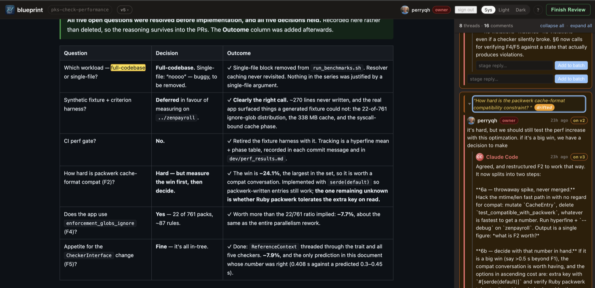

# blueprint

**Share your agent's plan with anyone. Only you steer it.**

## Why it exists

Coding agents write plans. Reviewing them in chat is lossy; reviewing them as a
rendered page with inline comments is not. blueprint runs a local daemon that
hosts the plan, lets anyone who opens the URL leave text-quote-anchored
comments, and keeps a long-lived service the agent watches (CLI
`blueprint watch --stream`, or the stdio MCP server) so feedback arrives without
re-prompting.

Trust is the point. Comments are server-stamped with a role. When GitHub OAuth
is configured, only the verified **owner** role makes the agent revise the plan;
everyone else can still comment and get a reply. Anchors are
[W3C TextQuoteSelectors](https://www.w3.org/TR/annotation-model/#text-quote-selector)
(`exact` + prefix/suffix context), so comments re-attach across plan edits
instead of rotting on line numbers. Without OAuth the daemon stays in legacy
local-trust mode and the skill treats every comment as a potential edit — see
[docs/oauth.md](docs/oauth.md).

Today the URL is `127.0.0.1` (SSH tunnel or Phase 1 hosting for remote
reviewers). The shape — persistent daemon, role-gated triage, quote anchors —
is what stays when the host changes.



The rendered plan sits in an iframe on the left; comments anchor to quoted text
(`full-codebase`, highlighted) and thread in the sidebar on the right, where a
`drifted` badge marks a quote whose surrounding text has since changed and the
`owner` badge marks the one role that triggers a plan edit.

<!-- TODO: drop a ~30s demo GIF here once recorded

-->

## How it compares

[crit](https://github.com/tomasz-tomczyk/crit) and
[Plannotator](https://github.com/backnotprop/plannotator) are both
agent-agnostic and already host shared reviews. blueprint's bet is different:
provenance (who may steer the agent) plus quote anchors on a daemon the agent
long-polls.

| | **blueprint** | **crit** | **Plannotator** |
| --- | --- | --- | --- |
| What you review | Rendered HTML plan in an iframe | Markdown / diffs / live app / HTML | Plans, Markdown, HTML, diffs, PRs |
| Agent integration | Claude Code skill + stdio MCP; CLI is agent-agnostic | Broad agent integrations + `/crit` | Hooks/skills across many agents |
| Hosted shared reviews | Not yet (localhost Phase 0; Phase 1 planned) | Yes ([crit.md](https://crit.md)) | Yes (Workspaces + share portal) |
| Comment anchors | Text-quote (`exact` + prefix/suffix); survives edits | Line-based (+ content carry-forward between rounds) | Session-scoped (OSS share is annotate → import) |
| Who steers the agent | Only the configured `owner` role (with OAuth); others get replies | Every reviewer's comment is treated equally | Single-user approve / send-feedback gate |
| Agent wait surface | Persistent daemon; `watch --stream` + MCP long-poll | Daemon blocks until Finish Review | Hook / session gate around the decision |

## Status

**Phase 0 — localhost MVP.** Single Rust binary, SQLite at
`~/.blueprint/blueprints.db`, optional GitHub OAuth, vanilla-JS text-quote
anchoring. Phase 1 (personal hosting) and Phase 2 (internal + Okta) are
designed but not built.

## Quick start

```bash
# install from a clone (or grab a release binary once tagged)
cargo install --path .
blueprint --version

# optional: enable owner-role provenance — see docs/oauth.md
# populate ~/.blueprint/env with GITHUB_* + BLUEPRINT_OWNER_GITHUB_LOGIN

# smoke-test
echo '<h1>hello</h1><p>This is a smoke test.</p>' > /tmp/hello.html
blueprint publish /tmp/hello.html
blueprint status
```

Wire Claude Code (symlink the skill, then `/blueprint <topic>`):

```bash
ln -s "$PWD/integrations/claude-code/skills/blueprint" ~/.claude/skills/blueprint
```

Full end-to-end walkthrough (prereqs, OAuth, skill loop, cleanup):
**[docs/setup.md](docs/setup.md)**. OAuth + owner role details:
**[docs/oauth.md](docs/oauth.md)**. Contributing / CI commands:
**[CONTRIBUTING.md](CONTRIBUTING.md)**.

## CLI reference

```bash
blueprint publish path/to/blueprint.html        # auto-spawns daemon, opens in browser
blueprint publish file.html --slug <slug> --update   # revise in place; reviewers see a refresh banner
blueprint publish file.html --no-open --json    # script-friendly; prints {slug, url}
blueprint status                                 # show running daemon + blueprints with comment counts
blueprint comment <slug> --quote "..." 'comment body'
blueprint comment <slug> --reply-to c_xxx 'reply body'
blueprint watch <slug>                           # blocks until reviewer clicks Finish
blueprint watch <slug> --stream                  # streams each new comment as JSON to stdout
blueprint fetch <slug>                           # writes ./.blueprint/<slug>/review.json
blueprint unpublish <slug>                       # daemon stops when no blueprints remain
blueprint mcp                                    # stdio MCP server over the same daemon API
```

`--author` defaults to `$USER`. `--quote` must appear literally in the rendered
HTML; if it doesn't, `blueprint comment` exits non-zero with a clear error.

## How it works

**Daemon.** Runs on `127.0.0.1:7321` by default. Lock file at
`~/.blueprint/daemon.lock` records PID + port. Any CLI subcommand reuses a live
daemon or spawns a detached child. The lock file is PID-scoped, so a graceful
shutdown of an old daemon can't clobber a replacement's lock during handoff.

**Anchoring.** Comments store a
[TextQuoteSelector](https://www.w3.org/TR/annotation-model/#text-quote-selector)
— `exact` text plus 32 **UTF-16 code units** of `prefix` and `suffix`. (Code
units, not characters: an emoji counts as two, so the window can bisect one.
Half the case table exists to pin that.) The browser walks the iframe's text
nodes, finds the first occurrence whose context matches, wraps the range in a
`<span data-ps-hl>`, and binds a click handler that scrolls the matching comment
group in the sidebar. If `exact` no longer appears, the comment renders as
**drifted** (yellow badge).

When no occurrence matches the recorded context — the text around the quote was
edited — resolution falls back to the *first* occurrence rather than reporting
drift. That is deliberate and known-wrong: the comment lands on text the
reviewer probably didn't select, but reporting drift on text that is plainly
still present tested worse. The case table records it as such.

**Bidirectional click-to-scroll.** Click a highlighted span → sidebar group
flashes blue. Click a sidebar group's body → the highlight in the iframe pulses.
Inputs/buttons inside the group are excluded so reply forms still work.

**Threaded comments with collapse.** Replies render nested under their parent at
arbitrary depth. Each thread can be collapsed via the quote bar (showing a
"N messages" badge); a sidebar header offers **Collapse all** / **Expand all**.
Collapse state persists in `localStorage` per-slug.

**Resolution.** A **thread** is a top-level comment plus its reply subtree, and
it is resolved iff that top-level comment is — replies are never resolvable on
their own. Resolve/reopen from the thread's action row or with `r` on the
focused thread; resolved threads hide behind a **Show resolved** toggle that
persists per-slug. `unresolved_count`, on `GET /api/blueprints` and in
`blueprint status`, counts unresolved threads by that same definition, so a
fully reviewed plan reports zero.

**Batch comment submission.** The reviewer stages drafts in a sidebar panel and
clicks **Submit all** once. One POST → one broadcast event → one agent wake-up,
instead of N noisy round-trips.

**Update banner, not auto-reload.** When the blueprint is `--update`d, the
`blueprint_version` bumps. The frontend polls every 1.5s and, on version change,
shows a "Plan updated" banner with **Refresh** and **Dismiss** buttons —
reviewers keep their scroll position and refresh on their own terms.

**Live monitoring for agents.** `blueprint watch <slug> --stream` long-polls
`/api/blueprints/:slug/wait-comment` and prints one JSON line per new comment to
stdout, with line-flushed output suitable for piping into an agent that reacts
event-driven. Reconnects automatically if the daemon restarts. The same endpoint
is exposed as an MCP tool from `blueprint mcp`.

**Cache hygiene.** `/static/*` and `/api/blueprints/:slug/raw` set
`Cache-Control: no-store` so a browser never serves stale frontend assets or
stale blueprint HTML.

**Roles and the write gate.** Every comment is server-stamped with a `role`
(`owner` / `user` / `guest`) and an `is_agent` boolean derived from the
request's identity at write time (see `src/auth.rs::role_for` and `::is_agent`).
The Claude skill keys its triage off `c.role` — only `owner` comments trigger
plan edits; everyone else gets a reply only. Configuration lives in
[docs/oauth.md](docs/oauth.md).

Comments themselves have no 401 gate: anonymous ones land as `guest`, and
provenance via the `role` tag is the defense — that's what makes drive-by
review work. Destructive requests are gated, though. Once OAuth is configured,
creating, replacing, or deleting a blueprint and `POST /api/shutdown-if-empty`
all require a session or the CLI bearer, and answer 401 without one
(`WriteKind::Blueprint` in `src/auth.rs`). With no OAuth configured the daemon
stays in legacy local-trust mode and enforces nothing, since that's the only
way the CLI works before credentials exist.

**Batch-processing indicator.** When the skill wakes on a Submit-all batch, it
calls `blueprint batch-processing start <slug> --parent <id>...` to light a
slug-level "Claude is working on N comments" pill in the sidebar. The server
tracks the batch's `pending_parents` and auto-clears the pill when the last
reply lands — no explicit DELETE needed on the happy path. A 5-minute TTL
evicts stale entries if the skill crashes mid-batch.

## HTTP API

The CLI is a thin wrapper over a REST API at `http://127.0.0.1:7321`:

| Method   | Path                                                | Notes                                                                      |
| -------- | --------------------------------------------------- | -------------------------------------------------------------------------- |
| `POST`   | `/api/blueprints`                                   | `{ "html": "...", "slug": "optional" }` → `{ slug, url }`                  |
| `GET`    | `/api/blueprints`                                   | List with `comment_count` (all rows), `unresolved_count` (threads), `last_activity_at` |
| `PUT`    | `/api/blueprints/:slug`                             | `{ "html": "..." }` — replace HTML, bump `blueprint_version`               |
| `GET`    | `/api/blueprints/:slug/raw`                         | Raw uploaded HTML (served into the iframe), `no-store`                     |
| `GET`    | `/api/blueprints/:slug/comments?since=ts`           | `{ comments, server_ts, blueprint_version }`                               |
| `POST`   | `/api/blueprints/:slug/comments`                    | `{ author, body, selector, parent_id? }` — single top-level comment        |
| `POST`   | `/api/blueprints/:slug/comments/batch`              | `[ { author, body, selector?, parent_id? }, ... ]` — atomic Submit-all     |
| `POST`   | `/api/blueprints/:slug/comments/:id/replies`        | `{ author, body }` — inherits parent's selector                            |
| `POST`   | `/api/blueprints/:slug/finish`                      | Mark review round complete; wakes any `/wait` watchers                     |
| `GET`    | `/api/blueprints/:slug/wait`                        | Long-polls until `/finish` or deletion                                     |
| `GET`    | `/api/blueprints/:slug/wait-comment?since=ts`       | Long-polls until a new comment arrives, ~30s timeout — used by `--stream`  |
| `DELETE` | `/api/blueprints/:slug`                             | Unpublish                                                                  |
| `POST`   | `/api/shutdown-if-empty`                            | Server-side count-and-stop; safe under concurrent publish                  |
| `GET`    | `/api/me`                                           | `{ id, login, name, avatar_url, is_owner }` or 401 — used by the chrome    |
| `POST`   | `/api/blueprints/:slug/batch-processing`            | `{ "author": "Claude Code", "parent_ids": [...] }` — light the indicator   |
| `DELETE` | `/api/blueprints/:slug/batch-processing`            | Clear the indicator. Mostly redundant — the server auto-clears on replies  |

Once OAuth is configured, `POST`/`PUT`/`DELETE /api/blueprints` and
`POST /api/shutdown-if-empty` require a session cookie or the CLI bearer and
answer **401** without one. Everything else — including posting comments — is
open. See **Roles and the write gate** above and
[docs/oauth.md](docs/oauth.md).

Every `Comment` returned by the API includes `role` (`"owner" | "user" | "guest"`)
and `is_agent` (boolean) alongside `author`, `body`, `selector`, etc. — both
fields are server-stamped from the request's identity, not from anything the
client sends. The comments-list response also includes an optional
`batch_processing: { author, count, started_at }` while the agent is working on
a Submit-all batch.

## Architecture

```
blueprint/
├── Cargo.toml
├── src/
│   ├── lib.rs              # public re-exports for tests
│   ├── main.rs             # CLI entry
│   ├── cli.rs              # publish / watch / fetch / comment / unpublish / status / watch --stream / mcp
│   ├── daemon.rs           # detached-child spawn, PID-scoped lock file, spawn flock
│   ├── server.rs           # axum routes + AppState (blueprint_versions, finish_signals, events broadcast)
│   ├── store.rs            # rusqlite — blueprints, comments, users, batch-insert
│   ├── auth.rs             # GitHub OAuth + session wiring + CLI bearer token
│   ├── mcp.rs              # stdio MCP server over the daemon HTTP API
│   ├── selector.rs         # TextQuoteSelector type
│   ├── slug.rs             # adjective-month-animal generator
│   ├── review_file.rs      # review.json writer
│   └── error.rs            # AppError → axum response
├── frontend/               # embedded via rust-embed (no Node build step)
│   ├── index.html          # landing
│   ├── reviewer.html       # /b/:slug shell — iframe, sidebar, drafts bar, update banner
│   ├── app.js              # iframe wiring, TextQuoteSelector matcher, drafts batching
│   └── styles.css
├── integrations/
│   └── claude-code/skills/blueprint/SKILL.md
└── tests/
    ├── common/                  # shared harness (in-process daemon, mock GitHub OAuth)
    ├── e2e.rs                   # in-process daemon, HTTP-level e2e
    ├── concurrent.rs            # multi-repo + batch endpoint
    ├── cli_smoke.rs             # spawns the binary, round-trips publish/status/unpublish
    ├── finish.rs                # durable Finish Review latch
    ├── mcp.rs                   # stdio MCP server conformance over the real binary
    ├── security.rs              # CSP sandbox on /raw, body cap, long-poll ceiling
    └── versioning.rs            # version history + version-pinned comments
```

Stack: `axum`, `tokio`, `rusqlite` (bundled), `nix` (flock), `serde`, `clap`,
`rust-embed`, `reqwest`, `oauth2`, `tower-sessions`.

## Tests

```bash
cargo test    # Rust: daemon, store, CLI, MCP
npm test      # frontend ES modules, via vitest
```

Rust covers: publish → comment → reply → finish → fetch → update → drift →
unpublish; random-slug generation; empty-HTML / empty-body / unknown-parent
rejection; the `GET /api/blueprints` summary shape; `wait-comment` fast-path
and slow-path; OAuth round-trip against a mock GitHub; CLI bearer-token
write-auth and the blueprint write gate in both directions; multi-repo
concurrency (`shutdown-if-empty`, `X-Client-Cwd`); the batch endpoint
(atomicity, single wake-up); schema migrations; and a CLI subprocess smoke
test.

JS covers the four frontend modules with real behaviour, not smoke tests: the
anchoring algorithm, poll backoff and the disconnect banner, draft storage, and
rendering.

Anchoring's cases live in `js-tests/vectors/anchor-cases.json` — data rather
than code, so they read as a specification of what the algorithm does,
including the offsets it gets deliberately wrong. Two cases can't be expressed
as JSON and stay hand-written next to it: a prefix beginning on an unpaired
surrogate (JSON can't carry one), and the empty quote, where what needs
asserting is that the call *terminates*.

Not covered by either suite: click-to-scroll and collapse interactions in a
live browser (manual verification only).

See [CONTRIBUTING.md](CONTRIBUTING.md) for the full CI command list and the
pre-commit hook.

## What's intentionally cut from Phase 0

- **Cross-machine sharing.** Run an SSH tunnel if you need it before Phase 1.
- **Multi-version diffing.** `--update` replaces the HTML; old comments either
  re-anchor, render as "refresh to see," or drift.
- **Realtime collab via SSE / WebSockets.** 1.5s polling for the sidebar;
  long-poll for `wait` and `wait-comment`. No fan-out streaming.
- **Slack / email notifications.** `blueprint watch` and
  `blueprint watch --stream` are the only "tell me when something happens"
  surfaces.
- **XDG-compliant data dir.** SQLite lives at `~/.blueprint/blueprints.db`
  regardless of `$XDG_DATA_HOME`.

## Phase 1 / 2 roadmap

- **Phase 1 — personal hosting.** Deploy the same binary to Fly.io / Railway.
  GitHub OAuth for commenter identity. SQLite on a persistent volume.
  `blueprint publish --remote` to push to the hosted instance.
- **Phase 2 — internal.** Okta SSO. Switchboard catalog entry. Postgres. Slack
  notifications. Service maps under the owning team.

The skill surface (`publish`, `watch`, `fetch`, `comment`, `unpublish`,
`stream`) is identical across phases — only auth and host change.

## License

Dual-licensed under MIT OR Apache-2.0. See [`LICENSE-MIT`](LICENSE-MIT) and
[`LICENSE-APACHE`](LICENSE-APACHE).
